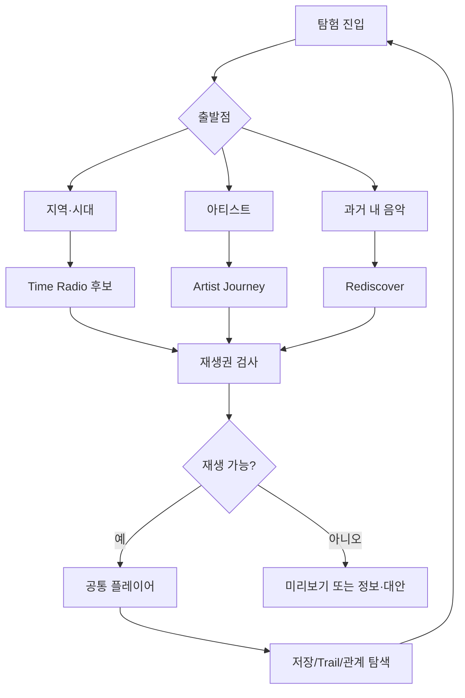

# UX/IA 설계 · 탐색이 곧 재생인 제품

## IA
현재 DIG 하위에 `Explore`, `Time Radio`, `Artist Journey`, `My Trails`, `Quests`를 도입하는 안입니다. Atlas가 성숙하면 `World Atlas`를 독립 진입점으로 노출할 수 있지만, 앱의 7대 축을 무단 변경하지 않습니다. Archive에는 `My Music History`와 `Rediscover`를 연결합니다.

## 화면 정의
| 화면 | 핵심 요소 | 다음 이동 |
|---|---|---|
| Explore Home | 최근 trail, 시대·지역 카드, 진행 중 Journey | Time Radio/Artist |
| Time Machine Setup | 시점(date), 지역(선택), 차트/언더그라운드/자유 모드, 당시/현대 관점 | 결과/재생 |
| Era Listening | 시간 캡, 현재 재생, 아티스트, 그때의 순위, 다음 달 버튼 | 앨범/지도 |
| Geo Atlas | 세계 지도+시대 슬라이더+범례, 필터 chips, list toggle | 지역·시대 목록 |
| Artist Journey | 앨범 연대기, 사건 카드, 트랙 미리듣기, 시대 맵 이동 | 앨범 비교/관계 |
| Relation Explorer | 선택 엔터티 중심 1-hop, 근거 툴팁, 앞/뒤 히스토리 | Trail 기록 |
| Collection/Passport | 아티스트·장르·시대별 큐레이션 목표 중 발견 수 | 재방문 |
| Quest Board | 진행 중/완료/미시작, 설명 가능한 조건, 보상 | 해당 탐험 |
| Rediscover | 나의 저장 날짜 vs 음악 발매 날짜, 기억 태그, 재발견 큐 | 보관함 |

## 사용자 흐름

## 인터랙션 세칙
- 시간 슬라이더를 드래그할 때는 로컬 year UI부터 반영하고 릴리스 후보는 조작 종료/디바운스 후 로딩. 브라우저 뒤로가기는 필터·시점 복원.
- 타임머신 진입 시 컷오프 날짜/타임존을 명시. 발매일이 `year` 정밀도만 있으면 같은 해 중 특정 일자 cutoff 충족으로 간주하지 않음(연말 cutoff라면 가능).
- 지역 핀은 `활동 지역`, `출신`, `녹음 장소`, `인기 차트 지역`의 범례를 별도 제공. '인기 있는 곳=만든 곳' 암시 금지.
- 라디오 선곡 기준을 '당시 인기', '숨겨진 음악', '자유 탐색'으로 구분. 차트 미확보 상태에서는 '당시 인기'를 허구로 표기하지 않음.
- 역사 모드는 미래 앨범 제목/결과뿐 아니라 사후 평론/선구적 업적 등 미래 사실을 숨김. 현대 해설 토글로 설명을 확장.
- 재생 중 퀘스트 토스트 최소화. 전체화면 플레이어 위의 진행도 UI는 기본 비활성.
- 퀘스트는 끄기/보상 숨기기 가능; 연속 출석·벌점·경쟁 강요 금지.
- 색상만으로 관계 종류 표시하지 않고 선 스타일, 아이콘, 접근성 레이블 병행.
- 지도 미지원 환경에는 동일한 시기/지역 필터의 목록 UI. 줄인 모션 선호 존중.
- 빈 결과는 '해당 시대에 음악 없음' 아닌 '현재 데이터/권리상 확인 가능한 곡 없음'으로 표현.

## 정보 아키텍처의 데이터 출처 라벨
`발매 사실(메타데이터 제공처)` / `검증된 관계` / `선언된 관계` / `추론` / `당시 차트(발행기관+발행일)` / `Rabit 내부 청취 차트` / `개인 청취 이력(동의 기반)`.

## UX 검증 과제
10명 내외 정성 연구 제안: 1983년 여행, 아티스트 변화 찾기, 잊힌 곡 찾기. 완료 시간·탐색 이탈·인지 부하·재생 선택 이유 설명 가능 여부를 측정. 연구 표본은 추정치 검증용이 아니라 문제 발견용입니다.
