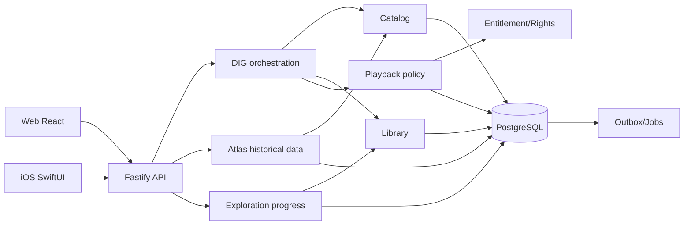

# 시스템 아키텍처 · 기존 modular monolith 확장

## 확인된 현행 기반
TypeScript 서버 modular monolith (`api/worker/media`), PostgreSQL, S3 호환 오브젝트 저장소(SeaweedFS), React 웹, SwiftUI iOS, 공통 AudioObject/Source, Catalog, Playback, Library, DIG, Search, Integrity. 이미 DigSession/Trail, Deep Cut, Crate, Blind Dig, Label Timeline이 존재합니다. Atlas는 설계 문서 기준 P2이며 실제 구현으로 가정하지 않습니다.

## 제안 bounded context 매핑
| 기능 | 소유 모듈 | 비고 |
|---|---|---|
| 앨범·아티스트·발매 판본·근거·지역 관계 | `catalog` | 정규화된 사실의 source of truth |
| 역사 차트 스냅샷/에디토리얼 후보 | 신규 `atlas` (승인 필요) | Rabit 참여자 지역 차트와 역사적 제공자 차트 분리 |
| 시대 필터, Trail, time radio 세션 | `dig` | 기존 trail 확장; 재생 엔진 소유하지 않음 |
| Artist Journey 읽기 모델 | `dig` 또는 `catalog` read service | 작곡·권리 사실을 복제하지 않음 |
| 퀘스트 정의·증빙·보상 | 신규 `exploration` (승인 필요) | 익명 게임 카운트와 개인 이벤트 분리 |
| 저장·재발견·개인 타임라인 | `library` | 사용자의 private data 및 export/delete 소유 |
| 청취 이벤트와 재생 권한 | `playback` | **기존 `evaluatePolicy` 재사용 필수** |
| 그래프 검색 인덱스 | `search` (derived) | 재구축 가능하고 권한 검증 후 표시 |
| 근거 검증·표시 | `integrity`/`catalog` | Verified ≠ ML inferred |
| 비동기 집계·큐 | `ops` | outbox, idempotency, retry, audit |

## 논리 아키텍처

## 서비스/트랜잭션 경계
- 모듈은 자기 테이블만 쓰고 의존 대상 공개 함수 (`index.ts`)만 호출; 기존 architecture test 유지.
- 역사 차트 ingest는 원본·라이선스 메타데이터를 보존하여 별도 stage→검증→publish. chart source별 정정은 스냅샷 버전 증가로 처리.
- Time Radio 후보 생성과 playback 시작은 별개: 후보가 발매일 컷오프를 만족해도 플레이어에서 현재 rights/entitlement를 재평가.
- 모듈간 완료 이벤트는 `outbox_event` → job; API request에서 타 모듈 테이블에 직접 쓰기 금지.
- `ExplorationProof`는 client 주장 아닌 서버 이벤트(정당한 DIG step, 정상 playback 세션, Archive 저장)에서 파생. 적립은 이벤트 유일성 키로 멱등.
- 모바일 클라이언트 타임라인 오프라인 캐싱 시 콘텐츠 검색 결과와 재생 자격을 혼동하지 않음.

## 성능 설계
- `cutoff_at`/region/type 기준 읽기 모델 및 DB 인덱스; 사용자별 세션 부하 분리.
- 라디오 큐는 10–25곡 seed, 중복 제한, 재생 가능한 후보 우선. paging cursor 안정화.
- 그래프는 1-hop 기본, 상한 50노드/100간선; 확장 시 lazy loading.
- 외부 차트 데이터는 요청시 공급자 직접 조회 대신 검증된 서버 스냅샷 제공.
- 추천 점수 계산은 후보 검색과 별도 계층, 버전/파라미터 감사 가능.

## 장애 처리
데이터 없는 연도 → 차트 기능만 disable, Catalog 탐색 유지. 차트 라이선스 중단 → 스냅샷 노출 중지. 추천기 실패 → 규칙 기반 후보. 정산/재생기 장애 → 기존 미디어 권한 정책에 따라 오류, 게임이 재생을 우회하지 않음. XP job 중복 → unique key로 멱등.
